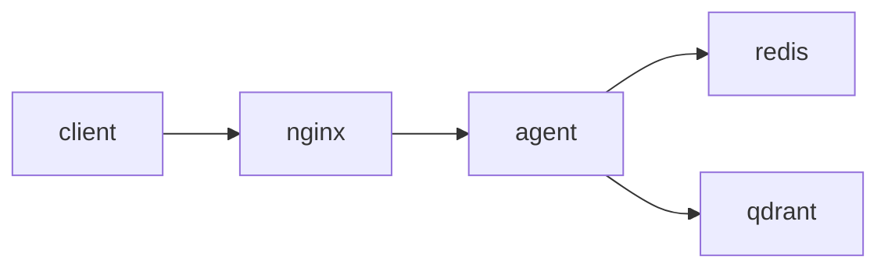

# Bài làm Part 2

## 2.1 Dockerfile cơ bản

1. Base image: `python:3.11`.
2. Working directory: `/app`.
3. Copy requirements trước để Docker tái sử dụng layer cài dependencies khi chỉ mã nguồn thay đổi.
4. `CMD` đặt lệnh hoặc đối số mặc định và dễ bị thay thế khi chạy container; `ENTRYPOINT` đặt chương trình chính, các đối số khi chạy thường được truyền cho chương trình đó.

## 2.2 Build

Đã build thành công bằng `docker build -f 02-docker/develop/Dockerfile -t my-agent:develop .`. Image `agent-develop` của người học được gắn thêm tag `my-agent:develop`. `docker image inspect` báo kích thước nội dung 426.319.951 byte (kích thước nén được Docker báo, không phải kích thước giải nén trên đĩa). Chạy ứng dụng trong container, `POST /ask?question=What%20is%20Docker` trả HTTP 200 và câu trả lời mock. Endpoint này nhận query parameter; gửi JSON theo lệnh trong đề không đúng hợp đồng endpoint.

## 2.3 Multi-stage build

Stage builder dùng `python:3.11-slim`, cài công cụ build và dependencies. Stage runtime dùng một image slim mới, chỉ copy packages đã cài và mã cần chạy, chạy dưới user không phải root. Không đưa compiler và các layer build vào runtime giúp giảm kích thước. Đã build image `my-agent:advanced`: `docker image inspect` báo 57.409.042 byte, so với 426.319.951 byte của basic (khoảng 86,5% nhỏ hơn theo cùng phép đo). Import FastAPI trong container thành công.

## 2.4 Kiến trúc Compose

Compose khai báo bốn service trên mạng nội bộ: Nginx nhận traffic và chuyển tới agent; cấu hình agent cung cấp URL của Redis và Qdrant. Redis và Qdrant dùng volume. Quan hệ thực tế còn phụ thuộc mã ứng dụng; các URL môi trường không tự chứng minh agent có sử dụng chúng.

Đã chạy stack với project `day14-ex2`: Redis, Qdrant và agent healthy, Nginx chạy; `GET /health` qua Nginx trả HTTP 200 và `POST /ask` với JSON trả câu trả lời mock. File `.env.local` được tạo với nội dung không có secret vì Compose yêu cầu file này. Đã dừng stack sau kiểm tra; volume vẫn được giữ lại.
